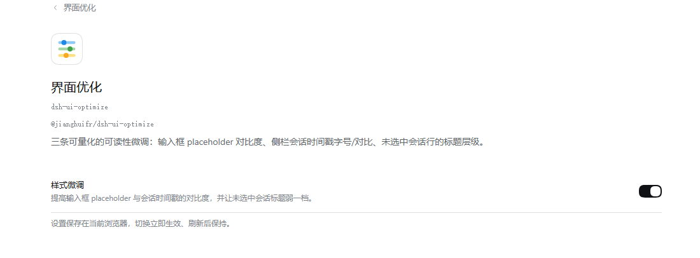

# @jianghuifr/dsh-ui-optimize

[](https://github.com/jianghuifr/dsh-ui-optimize/actions/workflows/ci.yml)
[](https://www.npmjs.com/package/@jianghuifr/dsh-ui-optimize)

Three measurable readability tweaks for the DeepSeek Harness Web UI: composer placeholder contrast, sidebar session timestamp type, and unselected session title hierarchy.

属于同一插件拆分出的三个独立包之一：[icons](https://github.com/jianghuifr/dsh-material-icon-theme-icon) · [dotfile highlight](https://github.com/jianghuifr/dsh-highlight) · [UI optimize](https://github.com/jianghuifr/dsh-ui-optimize)。

## 三条微调

| # | 选择器 | 改动 | 效果 |
| --- | --- | --- | --- |
| S1 | `[data-composer-placeholder]` | `color: var(--dsw-alias-label-secondary)` | 输入框 placeholder 对比度 2.14:1 → 约 5.9:1 |
| S2 | `[class*="_sidebarCol"] [class*="_timestamp"]` | `font-size: 11px` + `label-secondary` | 侧栏会话时间戳 10px/3.72:1 → 11px/5.9:1 |
| S3 | `[class*="_sessionRow"]:not([aria-selected="true"]) [class*="_title"]` | `color: var(--dsw-alias-label-secondary)` | 未选中会话标题比工作区标题弱一档 |

全部只用 `--dsw-*` 主题 token，关闭开关即整张样式表移除。


## 安装

```bash
# 发布到 npm 之后
plugin_manager install_bundle target=@jianghuifr/dsh-ui-optimize
```

本地开发也可直接 link 本目录（或在 Plugins → Add plugin 选择本目录）：

```bash
plugin_manager install_bundle target=<本仓库绝对路径>
```

## 设置页

**Plugins → Installed plugins → 本插件详情 → Components → `界面优化 ›`**



开关存在浏览器 `localStorage`，切换立即生效、刷新后保持；会从旧合并版 `dsh-material-icon-theme` 的共享 key 迁移一次。

## 开发

```bash
npm ci
npm run verify     # check + eslint + node --test
npm test
npm run check
```

零 npm 运行时依赖（仅 eslint 作为开发依赖），`lib/client.js` 是手写经典脚本、无构建步骤。

仓库结构：

```
lib/index.js       # 宿主半边
lib/client.js      # 客户端半边（经典脚本 bundle）
locale/            # en/zh 插件页 meta
test/              # node --test
scripts/check.mjs  # 自检
.github/workflows/ # CI + Release
docs/              # README 截图
```

## 发版

见 [docs/release.md](docs/release.md)：staged publishing + trusted publishing，CI 只暂存，维护者用 2FA 批准后上线。

## 已知边界

1. 选择器基于 App CSS Module 类名前缀，App 大改版后可能需要同步。
2. 只做这三条，不改变布局与交互。
3. 浏览器级设置：换浏览器/隐私模式回落默认（开）。

## 许可

MIT，见 [LICENSE](LICENSE)。
