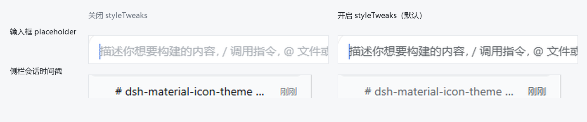

# @jianghuifr/dsh-ui-optimize

[](https://github.com/jianghuifr/dsh-ui-optimize/actions/workflows/ci.yml)
[](https://www.npmjs.com/package/@jianghuifr/dsh-ui-optimize)

对 DeepSeek Harness Web UI 做三处可读性优化，全部使用宿主主题 token，随浅色/暗色主题自动适配：

- 输入框 placeholder 对比度从 2.14:1 提升到约 5.9:1。
- 侧栏会话时间戳从 10px 提升到 11px，并提高对比度。
- 未选中会话的标题比工作区标题弱一档。



## 安装

```bash
plugin_manager install_bundle target=@jianghuifr/dsh-ui-optimize
```

也可以用本地目录：`plugin_manager install_bundle target=<本目录绝对路径>`。

安装后在 **Plugins → 本插件详情 → Components → `界面优化 ›`** 打开配置：


- `样式微调`（默认开）。
- 关闭后立即恢复应用原样。
- 设置保存在浏览器 localStorage，刷新后保持。

## 许可

MIT。
